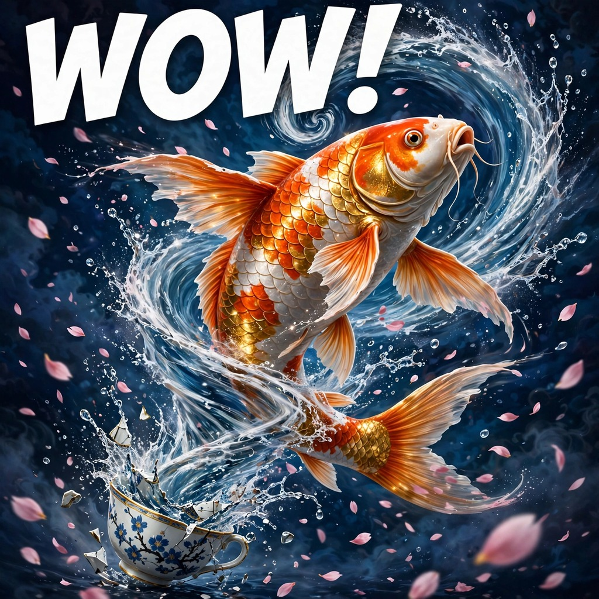

# The Teacup Koi — ai-excited-01

[](https://make.fun/c/ai-excited-01)
[](https://make.fun/c/ai-excited-01)
[](https://make.fun/c/ai-excited-01)

Entry for [make.fun's ai-excited-01](https://make.fun/c/ai-excited-01): one image made to get the AI judge excited.



A colossal golden koi bursts out of a tiny porcelain teacup — the whole ocean
trying to fit in a cup, and failing spectacularly. Water spirals up around it,
cherry-blossom petals fly, and the fish twists toward the viewer mid-leap.

## How it runs

`main.ts` (Node 22, standard library only) writes `entry.png` to
`/output/entry.png`. The output is deterministic: two runs produce
byte-identical files.

```sh
mkdir -p out && MAKEFUN_OUTPUT_DIR=out node main.ts
```

## License

MIT — see [LICENSE](LICENSE).
